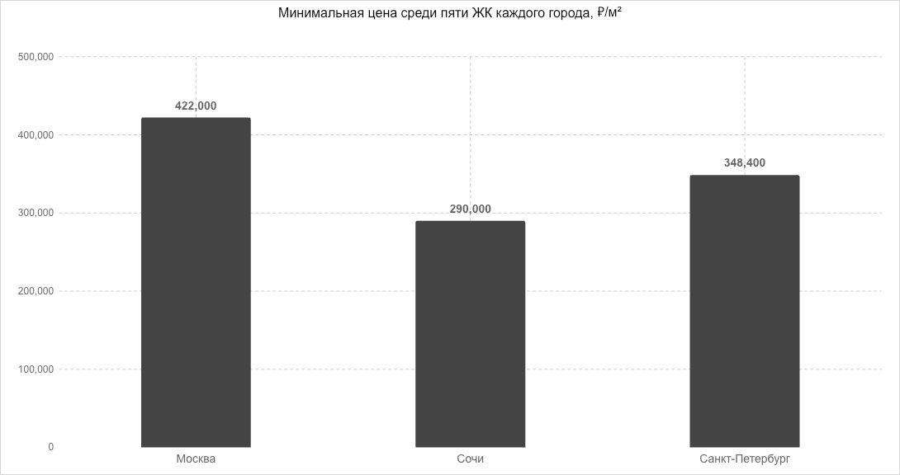

# Исследование новостроек

[Excel: график, расчёты, выводы и 15 ЖК](market-analysis.xlsx)

Данные проверки 13.11.2026: по 5 ЖК в Москве, Сочи и Санкт-Петербурге. Сравнивается минимальная опубликованная цена за м², без медиан и усреднения.

## Четыре вывода

1. Нижний порог Москвы — 422 000 ₽/м², Сочи — 290 000 ₽/м². Московский минимум выше на 46%.

2. Петербург с минимумом 348 400 ₽/м² находится между Москвой и Сочи. Сравниваются минимумы пяти выбранных ЖК каждого города.

3. Самый доступный стартовый метр — «Южный Парк» (290 000 ₽/м²), самый дорогой — «Прайм Парк (PRIME PARK)» (738 700 ₽/м²). Разброс — 2.55 раза.

4. Удивило: премиум Neva Residence (348 400 ₽/м²) ниже бизнеса James Beck (405 000 ₽/м²) на 14%. Класс не определяет стартовый метр: минимумы относятся к разным квартирам.

## Данные и метод

- [CSV с источниками и датами](complexes.csv), [полный снимок JSON](complexes.json).
- В Excel на листе «Анализ» одна редактируемая диаграмма, минимумы MINIFS, сравнения и выводы, связанные формулами с листом «Данные».
- PNG получен отрисовкой этой диаграммы, отдельный график в Python не строился.
- Это целевая выборка, а не оценка всего рынка. Состав классов и даты прайсов различаются; минимальная ставка не распространяется на произвольную площадь квартиры.
- Все таблицы и график без цветных выделений. Числа — в рублях за м²; у исходных цен и сроков есть ссылки.
